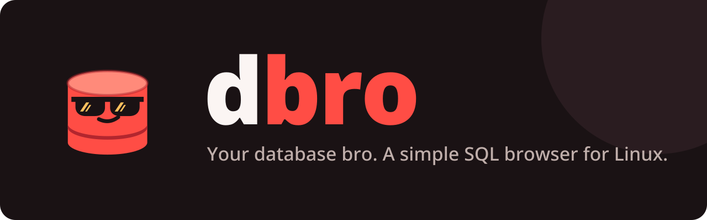
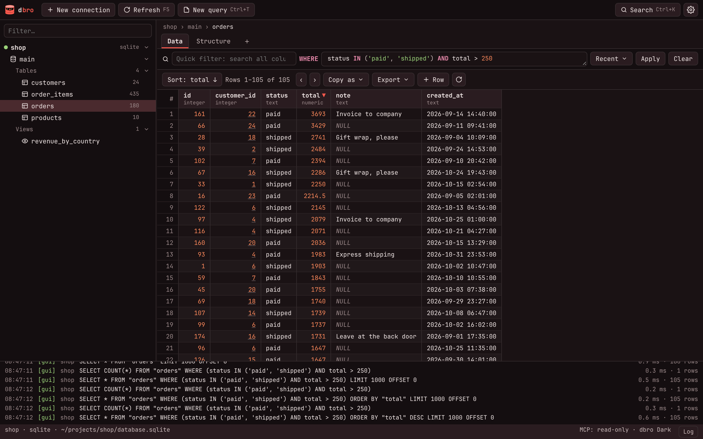
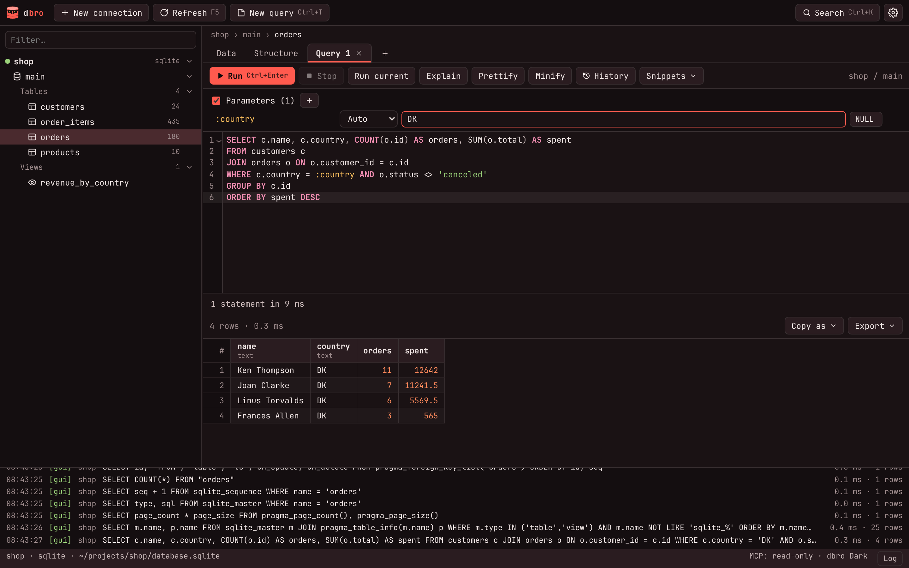
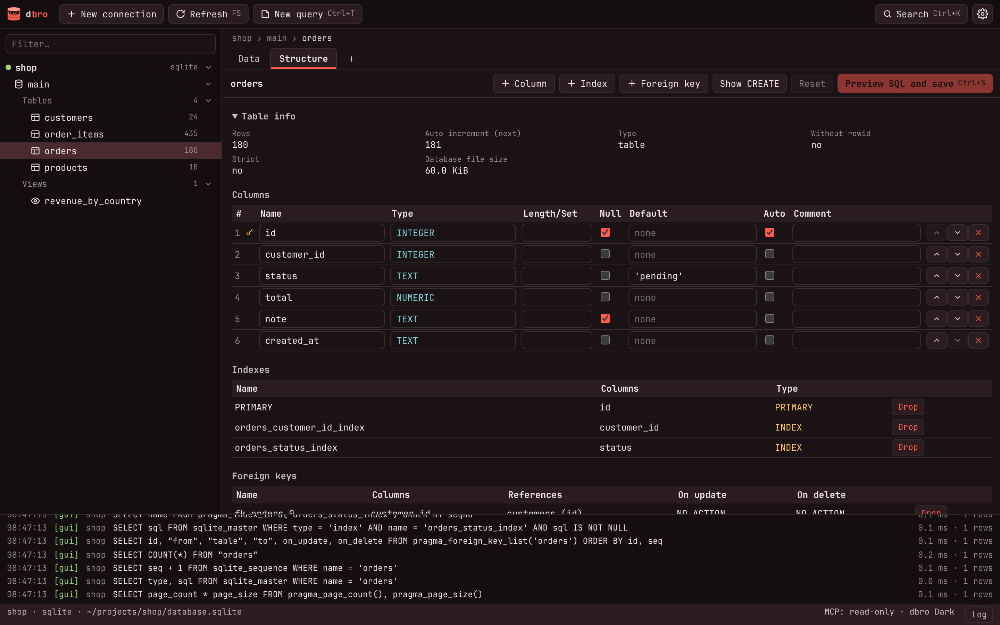
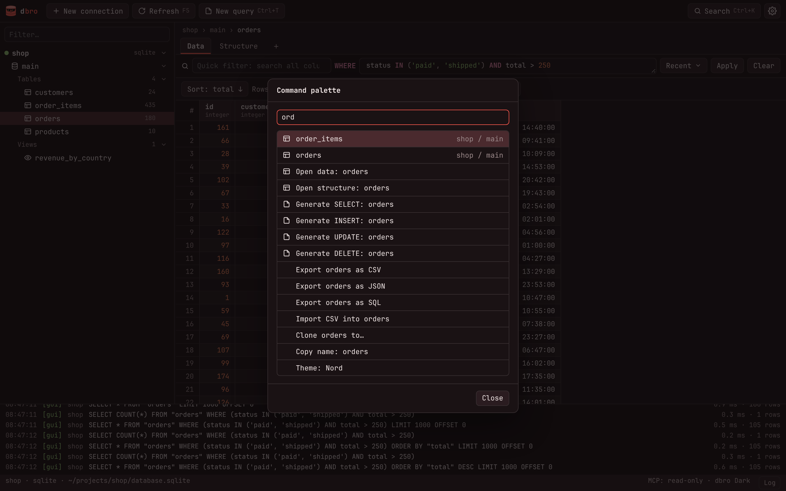

<p align="center"></p>

<p align="center"><a href="https://github.com/ExeQue/dbro/actions/workflows/ci.yml"></a> <a href="https://github.com/ExeQue/dbro/releases/latest"></a> <a href="LICENSE"></a></p>

**dbro** is a fast, keyboard-friendly database client for developers, built for Linux and available for macOS and Windows too. It talks to **MySQL, MariaDB, PostgreSQL and SQLite**, finds your local project databases by itself, follows your **[Omarchy](https://omarchy.org)** theme, and ships an **MCP server** so your agents can work with the same databases you do.

<p align="center"></p>

## Features

- **Connections** to servers and SQLite files, with SSL/TLS and SSH tunnels. Passwords live in the system keyring, never on disk.
- **Data grid** with paging, sorting, a WHERE filter, inline editing with a change queue, NULL handling, a side editor for JSON and long text, foreign-key following, and copy as CSV, TSV, JSON, SQL, Markdown or a PHP array.
- **Schema editor**: create, rename, truncate and drop databases and tables; add, change, move and drop columns, indexes and foreign keys, always with a SQL preview first. SQLite tables are rebuilt where `ALTER TABLE` falls short.
- **Quick access**: a command palette (Ctrl+K) that jumps to any project, connection, database or table and runs actions, run the statement under the cursor (Alt+Enter), filter from any cell, and generated SELECT/INSERT/UPDATE/DELETE statements.
- **Query tabs** with CodeMirror, named and positional parameters, autocomplete for tables and columns, several result sets, EXPLAIN, a per-connection history and saved snippets.
- **Import and export**: tables and results to CSV, JSON or SQL; full SQL dumps; SQL and CSV import; **Clone to** another database or connection, across drivers.
- **Themes**: dbro Dark and Light (picked from your system preference on first start), Tokyo Night, Catppuccin, Gruvbox, Nord, your own in `~/.config/dbro/themes/*.toml`, or live sync with Omarchy. See [Themes](docs/themes.md).
- **MCP server** for agents (stdio or streamable HTTP): read-only by default, writes only on connections you allow, connections can be hidden.
- **Headless mode**: `dbro serve` puts the app in a web browser on a port, embeddable in other applications.

## Screenshots

<table>
  <tr>
    <td></td>
    <td></td>
  </tr>
  <tr>
    <td align="center">Queries with named parameters</td>
    <td align="center">Schema editor with table info</td>
  </tr>
  <tr>
    <td></td>
    <td></td>
  </tr>
  <tr>
    <td align="center">Command palette (Ctrl+K)</td>
    <td></td>
  </tr>
</table>

## Integrations

Lerd, Omarchy and the desktop portal are Linux only; the rest works on Linux, macOS and Windows.

- **[Lerd](https://lerd.sh)**: every Lerd project shows up with its own database, found the way Lerd does it, from the project's framework definition (Laravel, Symfony, WordPress, Drupal, Craft and the rest Lerd knows, including git worktrees). Lerd's MySQL and PostgreSQL services are listed too and connect on startup.
- **[Laravel](https://laravel.com)**: point a connection at a project folder and dbro reads the database settings from its `.env` on every connect.
- **[Omarchy](https://omarchy.org)**: the theme follows Omarchy's current theme live, including theme switches.
- **[MCP](https://modelcontextprotocol.io)**: agents such as [Claude Code](https://claude.com/claude-code) get your saved connections over stdio or streamable HTTP, read-only by default. See [MCP for agents](#mcp-for-agents).
- **OpenSSH**: tunnels read `~/.ssh/config` (host aliases, `ProxyJump`), use ssh-agent and check `known_hosts`.
- **System keyring**: passwords go to the Secret Service on Linux (GNOME Keyring, KWallet), the Keychain on macOS and the Credential Manager on Windows.
- **Desktop portal**: file pickers and the light/dark preference come from the XDG desktop portal, so they match your desktop.

## Install

Builds for every release are on [Releases](https://github.com/ExeQue/dbro/releases): Linux (amd64, arm64), macOS (universal: Apple Silicon and Intel) and Windows (amd64, also runs on Windows on Arm).

### Linux

Needs GTK 3 and WebKitGTK 4.1, and glibc 2.35 or newer: Ubuntu 22.04, 24.04 and 26.04, Debian 12 and 13, Fedora 36 and later, any current Arch. Every release is checked to start on those Ubuntu and Debian versions.

| Distribution | Dependencies |
|---|---|
| Ubuntu, Debian, Mint, Pop!_OS | `sudo apt install libgtk-3-0 libwebkit2gtk-4.1-0` |
| Fedora | `sudo dnf install gtk3 webkit2gtk4.1` |
| openSUSE | `sudo zypper install libgtk-3-0 libwebkit2gtk-4_1-0` |
| Arch, Omarchy, Manjaro | `sudo pacman -S --needed gtk3 webkit2gtk-4.1` |

Then install the latest release into `~/.local` (picks amd64 or arm64 for you):

```sh
arch=$(uname -m | sed 's/x86_64/amd64/; s/aarch64/arm64/')
ver=$(curl -fsSL https://api.github.com/repos/ExeQue/dbro/releases/latest | grep -o '"tag_name": *"[^"]*"' | cut -d'"' -f4)
curl -fsSL "https://github.com/ExeQue/dbro/releases/download/$ver/dbro-$ver-linux-$arch.tar.gz" | tar -xz -C /tmp
cd "/tmp/dbro-$ver-linux-$arch"
install -Dm755 dbro ~/.local/bin/dbro
install -Dm644 dbro.desktop ~/.local/share/applications/dbro.desktop
install -Dm644 dbro.png ~/.local/share/icons/hicolor/1024x1024/apps/dbro.png
```

Make sure `~/.local/bin` is on your `PATH`. To uninstall, delete those three files.

**Arch, Omarchy, Manjaro**: or build a proper package from the included PKGBUILD, so pacman tracks the files and the dependencies:

```sh
git clone https://github.com/ExeQue/dbro && cd dbro/packaging/aur/dbro-bin && makepkg -si
```

### macOS

macOS 12 or newer (the Go runtime requires it). The build is not notarized, so the quarantine flag has to be cleared once:

```sh
ver=$(curl -fsSL https://api.github.com/repos/ExeQue/dbro/releases/latest | grep -o '"tag_name": *"[^"]*"' | cut -d'"' -f4)
curl -fsSLo /tmp/dbro.zip "https://github.com/ExeQue/dbro/releases/download/$ver/dbro-$ver-macos-universal.zip"
unzip -oq /tmp/dbro.zip -d /Applications
xattr -dr com.apple.quarantine /Applications/dbro.app
sudo ln -sf /Applications/dbro.app/Contents/MacOS/dbro /usr/local/bin/dbro   # optional: the CLI for dbro mcp / dbro serve
```

### Windows

Windows 10 or 11 with the WebView2 runtime (built into Windows 11; on Windows 10 it comes with Edge). In PowerShell:

```powershell
$ver = (Invoke-RestMethod https://api.github.com/repos/ExeQue/dbro/releases/latest).tag_name
$dir = "$env:LOCALAPPDATA\Programs\dbro"
Invoke-WebRequest "https://github.com/ExeQue/dbro/releases/download/$ver/dbro-$ver-windows-amd64.zip" -OutFile "$env:TEMP\dbro.zip"
Expand-Archive "$env:TEMP\dbro.zip" $dir -Force
# Start menu shortcut
$lnk = (New-Object -ComObject WScript.Shell).CreateShortcut("$env:APPDATA\Microsoft\Windows\Start Menu\Programs\dbro.lnk")
$lnk.TargetPath = "$dir\dbro.exe"; $lnk.Save()
# optional: dbro on PATH for dbro mcp / dbro serve
[Environment]::SetEnvironmentVariable('Path', [Environment]::GetEnvironmentVariable('Path', 'User') + ";$dir", 'User')
```

The build is not signed, so SmartScreen asks on first start (More info, Run anyway).

### From source

Needs Go, Node, the Wails CLI and, on Linux, `webkit2gtk-4.1`.

```sh
go install github.com/wailsapp/wails/v2/cmd/wails@latest
make install        # builds and installs to ~/.local (binary, .desktop file, icon)
```

## Themes

Seven built-in themes, light or dark from your system, live [Omarchy](https://omarchy.org) sync, and your own themes as TOML files. See [docs/themes.md](docs/themes.md) for the gallery and the theme format.

## MCP for agents

```sh
claude mcp add dbro -- dbro mcp                                   # stdio
dbro mcp --http                                                   # streamable HTTP on 127.0.0.1:7811
claude mcp add --transport http dbro http://127.0.0.1:7811/mcp
```

Tools: `list_connections`, `list_databases`, `list_tables`, `describe_table`, `query` (always in a read-only transaction) and `execute` (only where *Allow agents to change data* is on). Agent statements appear in the app's SQL log marked `[mcp]`.

## Headless mode

`dbro serve` runs the app without a window: open the printed URL in any browser. MCP is served at `/mcp` on the same port.

```sh
dbro serve                                  # http://127.0.0.1:7810/
DBRO_TOKEN=secret dbro serve --addr 0.0.0.0:7810
```

- On loopback without a token, only `localhost`/`127.0.0.1` host names are accepted and the UI cannot be framed by other sites.
- With a token (set `DBRO_TOKEN`; generated automatically beyond loopback), the API, events and MCP need `Authorization: Bearer <token>` or `?token=`. Any application that knows the token can embed the UI: `<iframe src="http://127.0.0.1:7810/?token=secret">`.
- Plain HTTP: put a TLS proxy in front when you listen beyond your own machine.
- File pickers (import, export, dump) use the desktop portal of the machine dbro runs on, so they only work when `dbro serve` runs in a desktop session.

## Files

| Path | What |
| --- | --- |
| `~/.config/dbro/connections.toml` | saved connections (no passwords) |
| `~/.config/dbro/config.toml` | settings |
| `~/.config/dbro/themes/*.toml` | your themes, Omarchy `colors.toml` format |
| `~/.config/dbro/snippets.json` | saved queries |
| `~/.local/state/dbro/` | SQL log and query history |

## Development

```sh
make dev     # the app with hot reload
make test    # Go tests
```

See [CONTRIBUTING.md](CONTRIBUTING.md) for setup, running the MySQL and PostgreSQL tests, and guidelines.

## License

MIT, see [LICENSE](LICENSE).
