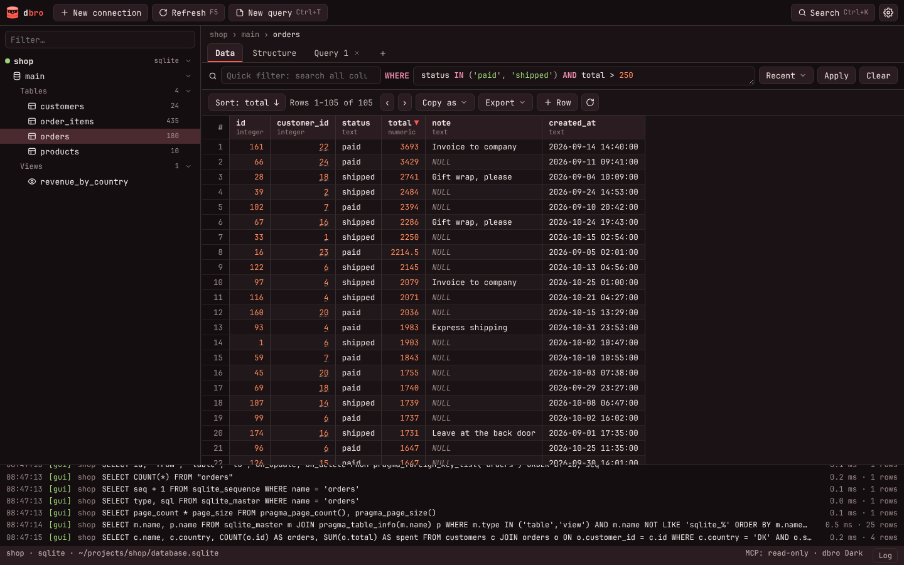
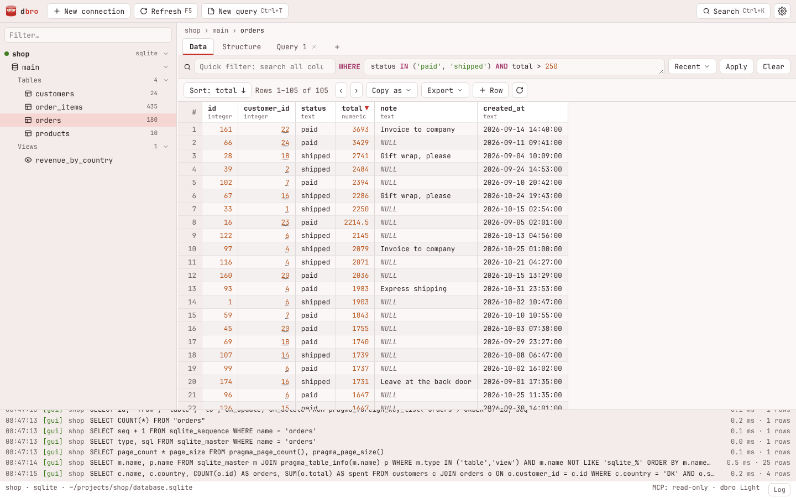
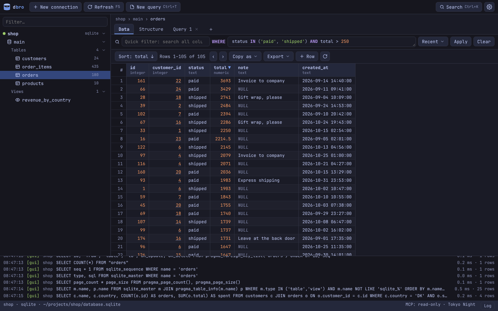
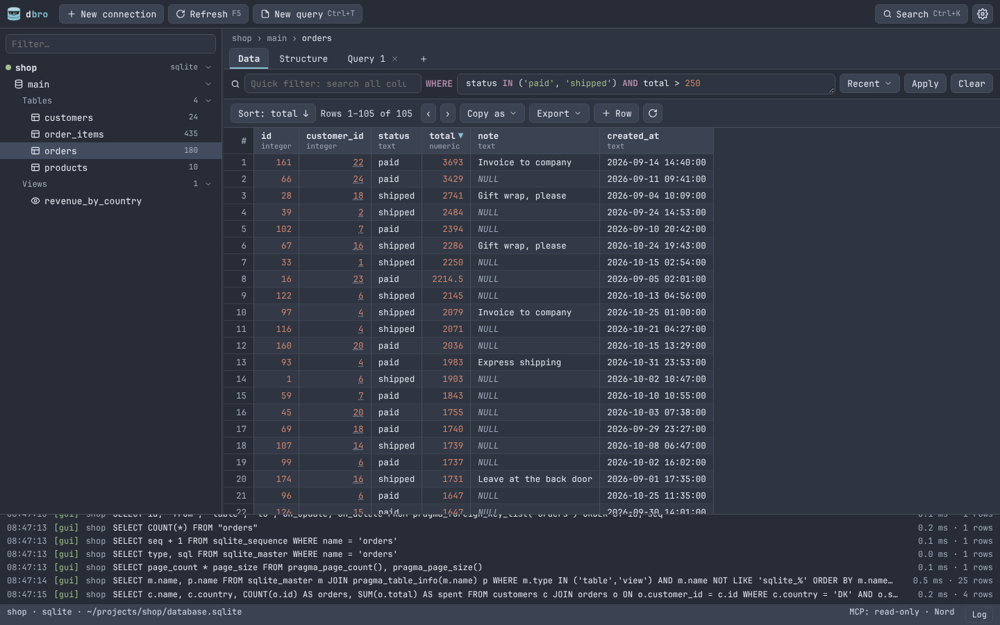
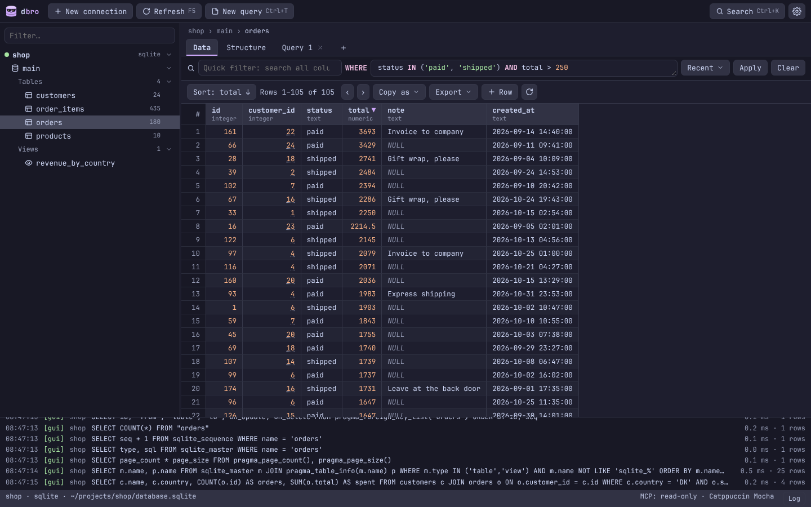
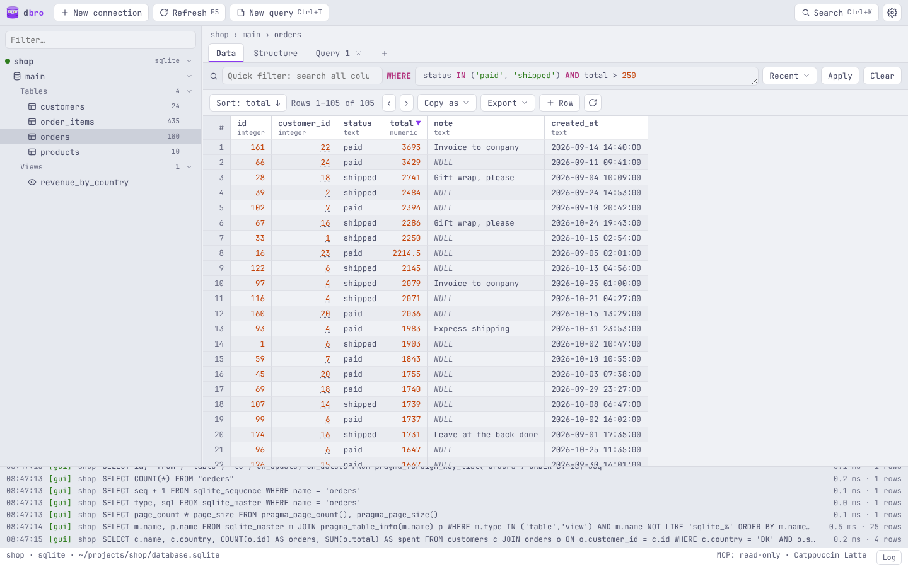
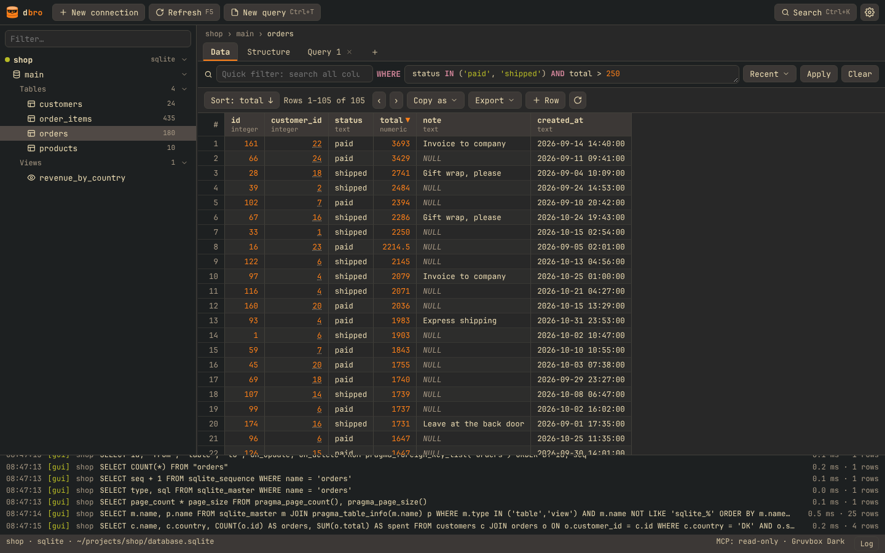

# Themes

dbro ships seven themes, follows your system's light or dark preference, can sync live with [Omarchy](https://omarchy.org), and takes your own themes as plain TOML files.

<table>
  <tr>
    <td></td>
    <td></td>
  </tr>
  <tr>
    <td align="center">dbro Dark</td>
    <td align="center">dbro Light</td>
  </tr>
  <tr>
    <td></td>
    <td></td>
  </tr>
  <tr>
    <td align="center">Tokyo Night</td>
    <td align="center">Nord</td>
  </tr>
  <tr>
    <td></td>
    <td></td>
  </tr>
  <tr>
    <td align="center">Catppuccin Mocha</td>
    <td align="center">Catppuccin Latte</td>
  </tr>
  <tr>
    <td></td>
    <td></td>
  </tr>
  <tr>
    <td align="center">Gruvbox Dark</td>
    <td align="center">or your own, or live Omarchy sync</td>
  </tr>
</table>

Pick a theme in **Settings** (Ctrl+,) or from the command palette (Ctrl+K, type `theme`).

## System and Omarchy

- **System** uses dbro Dark or dbro Light, following the desktop's color-scheme preference (the XDG desktop portal on Linux), and switches along when it changes. It is the default on first start.
- **Omarchy (sync)** appears on Omarchy. dbro reads Omarchy's current theme and follows every theme switch live. On the first start on Omarchy, dbro asks whether to turn this on.

## Your own themes

A theme is a TOML file in `~/.config/dbro/themes/` (or `$XDG_CONFIG_HOME/dbro/themes/`). The file name is its ID and gives it its name: `solarized-dark.toml` shows up as *Solarized Dark*. dbro reloads a theme when its file changes, so you can edit it with the app open.

The quickest start is **Settings → Save current as theme…**, which writes the colors of the theme you are looking at to a new file you can then edit.

The format is Omarchy's `colors.toml`, so an Omarchy theme's colors work as they are. Every key is optional: missing keys come from dbro Dark, or dbro Light when `mode = "light"`.

```toml
mode = "dark"                    # "dark" or "light"

# surfaces
background = "#1a1214"           # main background
dark_background = "#140e10"      # toolbar, sidebar, filter bar, row numbers
darker_background = "#0e0a0b"    # dialog backdrop
lighter_background = "#2a1c20"   # status bar, buttons, table headers, menus
selection = "#4a2a2e"            # selected rows, tree items and text

# text
foreground = "#eee4e3"
dark_foreground = "#9c8a8b"      # secondary text, hints, NULL
light_foreground = "#c9b9b9"     # tabs, status bar, labels
bright_foreground = "#fff6f5"
muted = "#8a7476"

# accent and syntax colors
accent = "#ff5a4e"               # primary buttons, focus, active tab
red = "#ff5a4e"                  # errors, destructive actions
orange = "#ff8a5c"               # numbers
yellow = "#ffc15e"               # changed cells, keys, MCP log entries
green = "#9bd27a"                # new rows and columns
cyan = "#7fd1d6"                 # column types
blue = "#82aaff"
magenta = "#f28fb3"              # SQL keywords, WHERE label
brown = "#a8735a"
bright_red = "#ff7f75"
bright_yellow = "#ffd48a"
bright_green = "#b6e39a"
bright_cyan = "#a3e3e6"
bright_blue = "#a6c2ff"
bright_magenta = "#f7b0ca"
```

Every key becomes a CSS variable (`dark_background` is `--dark-background`), so any key you add is available too.

### The logo

The logo follows `accent`. A theme can recolor it in detail with these optional keys:

```toml
logo_body = "#a3be8c"   # the cylinder
logo_lid = "#c8dcb4"    # its top
logo_band = "#6f8a5a"   # the disk band and rim
logo_glint = "#ebcb8b"  # the sunglasses' glints
logo_ink = "#20242c"    # sunglasses and smile
```

## Font

**Settings → Font** sets the UI font; empty means your system's monospace font (from fontconfig on Linux).
